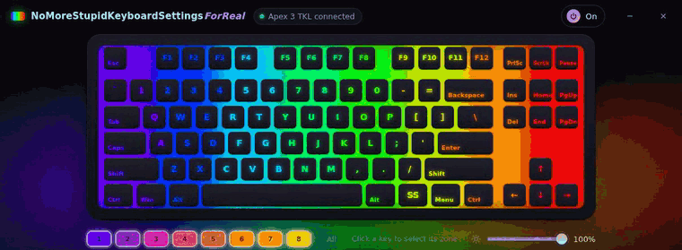
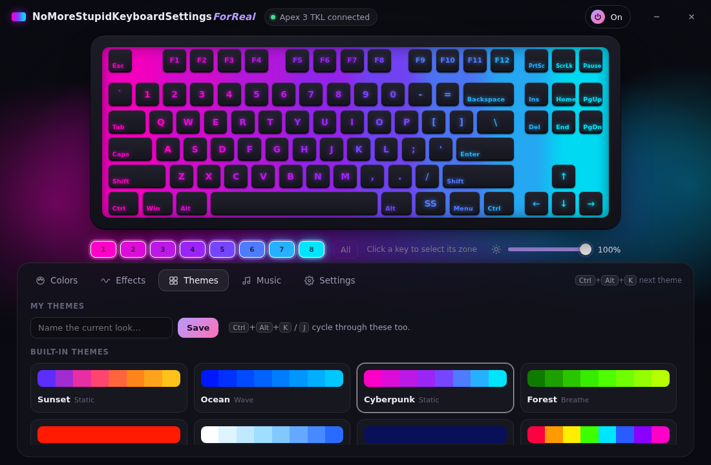

# NoMoreStupidKeyboardSettingsForReal

**Lighting for the SteelSeries Apex 3 TKL, without installing SteelSeries GG.**

<p align="center"></p>

I wanted to change my keyboard's color. SteelSeries GG wanted to install an audio suite, a mixer, background services and an account. So this is one 1.6 MB `.exe` that changes the color, and that's it.

## What it does

- **8 zones, any color.** Click a key to pick its zone, or paint a left-to-right gradient across the whole board.
- **Effects:** Static, Breathe, Wave, Rainbow, Color Cycle, Starfall, Fire, and the keyboard's own built-in wave.
- **Music mode:** the keyboard reacts to whatever your PC is playing (Spotify, YouTube, games). It listens to the output (WASAPI loopback), never the microphone, and records nothing.
- **Themes:** 16 built-in ones, plus save your own look with a name.
- **Global shortcuts:** `Ctrl+Alt+K` / `J` next / previous theme, `Ctrl+Alt+L` lights on/off, `Ctrl+Alt+M` music mode.
- **Stays out of the way:** lives in the tray next to the clock, uses no window when closed, can start with Windows.
- **Puts your colors back** after sleep, restart or unplugging. The Apex 3 TKL has no onboard memory, so without an app it falls back to its rainbow.
- English and Turkish, picked from your Windows language.

<p align="center"></p>

## Download

Grab `NoMoreStupidKeyboardSettingsForReal.exe` from the [latest release](../../releases/latest) and run it. No installer.

- Windows 10/11, 64-bit. The settings window uses Microsoft WebView2, which comes with Windows 11. On Windows 10 the app links you to the installer if it's missing.
- The exe isn't code-signed, so SmartScreen will say "Windows protected your PC". Click **More info → Run anyway**. Or read the code and build it yourself (below).
- Settings are stored in `%APPDATA%\NoMoreStupidKeyboardSettingsForReal`. To uninstall, quit from the tray and delete the exe and that folder.

## Supported keyboards

| Keyboard | USB ID | Status |
|---|---|---|
| SteelSeries Apex 3 TKL | `1038:1622` | ✅ used daily |

Other 8-zone SteelSeries boards (like the full-size Apex 3) probably speak the same protocol with a different product ID, but I can't test them. If you have one, open an issue with its USB ID, or a PR.

## How it works

The keyboard understands a few HID feature reports on interface 1 (usage page `0xFFC0`):

| Report | What |
|---|---|
| `0x21` | set the 8 zone colors |
| `0x22` | switch to the built-in rainbow |
| `0x23` | brightness, 0–16 |

That's all the keyboard can do by itself. Every animated effect is rendered by the app at 30 fps and sent as a stream of `0x21` reports. Static colors are re-sent once a second, so the keyboard recovers after sleep.

The protocol comes from [OpenRGB](https://gitlab.com/CalcProgrammer1/OpenRGB)'s `SteelSeriesApex8ZoneController`. Thank you to the OpenRGB people.

```
src/cihaz.rs     HID protocol              src/efekt.rs     effects (pure, testable)
src/motor.rs     find keyboard, 30 fps     src/ses.rs       WASAPI loopback + FFT
src/panel.rs     window, tray, shortcuts   src/panel.html   the UI (WebView2)
```

Code identifiers are in Turkish, because that's how I think. The UI and these docs are in English.

## Build

Cross-compiled from Linux with the GNU toolchain. That's the build I ship:

```bash
rustup target add x86_64-pc-windows-gnu
sudo apt install mingw-w64
cargo build --release --target x86_64-pc-windows-gnu
```

The `WebView2Loader.dll` that the GNU build needs is embedded in the exe (see `src/yukleyici.rs`), so you still ship one file.

### Trying the UI without Windows or the keyboard

```bash
cargo test                  # packet format, effects, audio bands
cargo run --release         # → http://127.0.0.1:4917/  (same UI, fake keyboard, fake music)
NMSKS_DIL=tr cargo run --release   # same thing in Turkish
```

## License

[GPL-2.0-or-later](LICENSE), because the protocol work it builds on (OpenRGB) is GPL-2.0.

Not affiliated with or endorsed by SteelSeries. "SteelSeries", "Apex" and "SteelSeries GG" are their trademarks.
